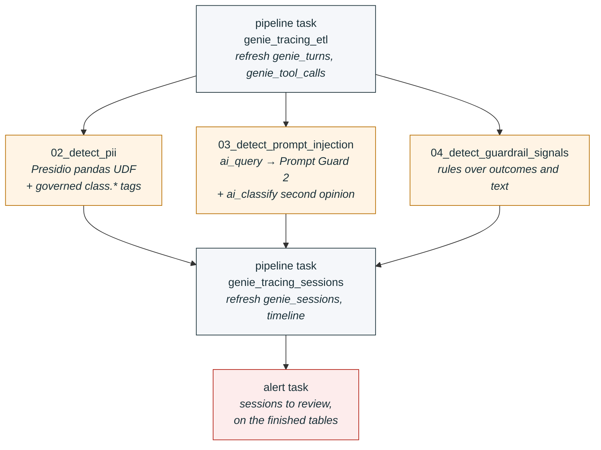
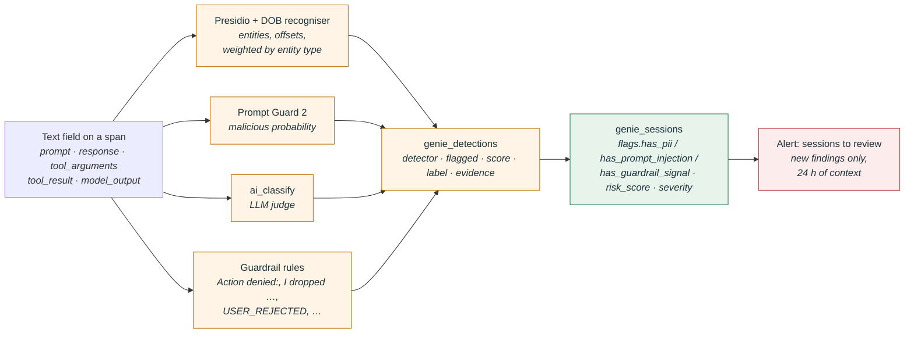

# Genie trace monitoring

A trust-but-monitor accelerator for Databricks **Genie One** and **Genie Code**, built on the
Unity Gateway unified trace table. It flattens every Genie turn and tool call into queryable
tables, runs PII, prompt-injection and guardrail-signal detections over them, rolls the results
up per session with a severity, and sends one alert listing the sessions worth reviewing.

Everything is a [Databricks Asset Bundle](https://docs.databricks.com/dev-tools/bundles/):
two serverless Lakeflow pipelines, two jobs (one-time setup and hourly monitoring), one SQL alert,
seven notebooks, deployable to any
workspace with a single `databricks bundle deploy`.

## Contents

- [Why](#why)
- [How it works](#how-it-works)
- [What gets built](#what-gets-built)
- [Quick start](#quick-start)
- [Detections](#detections)
- [Tuning](#tuning)
- [PII: Presidio and Data Classification](#pii-presidio-and-data-classification)
- [What the trace does and does not contain](#what-the-trace-does-and-does-not-contain)
- [Related platform controls](#related-platform-controls)
- [Repository layout](#repository-layout)
- [License](#license)

## Why

Customers adopting Genie raise three concerns that the product does not answer on its own:

| Concern | What Genie does today | What this accelerator adds |
|---|---|---|
| Users paste PII into prompts and it reaches the LLM | No redaction before the model call. Zero-retention agreements with model partners. | Row-level PII detection on prompts, responses, tool arguments and tool results; governed `class.*` tags on the columns; per-session `has_pii` flag and a severity weighted by entity type (a card number outranks a name). |
| How strong are the guardrails and safety classifiers | Genie Code: deterministic hard-blocks, AI safety inspection, human approval or an intent-based Auto-approve classifier. Genie One: scope-based Auto-approve for tool actions, otherwise architectural controls plus a system-prompt topic check. | Transparent rules over the *outcomes* the trace does record (refusals, rejected or denied tool calls, approval requests, destructive tool arguments, refusal text) with a per-session `risk_score`. |
| Does Auto-approve open the door to prompt injection | The approval classifier excludes retrieved content from its context, but nothing surfaces attempts to an admin. | Llama Prompt Guard 2 via `ai_query` over prompts (direct) and tool results (indirect), with an `ai_classify` second opinion. |

## How it works

### Data flow


Five stages, left to right: the raw Unity Gateway spans are flattened into turns and tool calls,
the detectors scan every free-text field and write one row per finding, the session rollup joins
it all back together per conversation with a `risk_score` and `severity`, and the "sessions to
review" alert reports sessions with new findings. Dashed boxes are sources the bundle does not
own; the orange table is the only one written by notebooks rather than a pipeline; green is where
triage starts; red is the alert. Source SVG: `docs/table_guide_architecture.svg`, rendered by
`docs/render_diagram.sh`.

### What runs when

The hourly job `genie_tracing_monitoring` drives everything. The three detectors run in parallel
and each only scans text it has not seen before; the guardrail rules re-score their whole lookback
window so pattern changes update history, and the PII step re-weights existing findings. The
sessions rollup runs even if a detector failed, and the alert is evaluated last, against the
finished tables.



### How a flag is born



## What gets built

```
<catalog>.genie_tracing
├── genie_turns              MV     one row per turn (root span): when/who, keys, prompt, response + outcome / context / span / completeness / links structs
├── genie_tool_calls         MV     one row per tool call / approval / question / model call: when/who, keys, tool, arguments, result + outcome / span structs
├── genie_detections         table  one row per (span, detector, field): when/who, detector, flagged, score, label + span struct, evidence
├── genie_sessions           MV     one row per conversation: when/who, is_flagged, risk_score, severity + activity / flags / risk / feedback / context structs
├── genie_session_timeline   view   ordered step-by-step walkthrough: when/who, position, event, text, is_flagged + outcome / detections / span structs
└── genie_tracing_libs       volume wheels for Presidio's spaCy model
```

**Column convention** across all tables: when, then who, then keys, then any free text (prompt,
response, tool arguments and results) as flat columns because they are scanned and may carry PII
row to row, then one or two headline flags, then metadata grouped into structs (`outcome`,
`context`, `span`, `completeness`, `links`, `flags`, `risk`, `activity`, `feedback`,
`detections`). Reach into a struct with dot notation, e.g. `outcome.run_outcome`.

Pipelines use materialized views so a refresh picks up late or re-exported spans. Switch
`genie_turns` and `genie_tool_calls` to streaming tables if you prefer append-only incremental
processing (`CREATE OR REFRESH STREAMING TABLE ... FROM STREAM(...)`).

### Bundle resources

| Resource | File | Purpose |
|---|---|---|
| Schema + volume | `resources/genie_tracing.schema.yml` | Target schema and wheel volume |
| Pipeline `genie_tracing_etl` | `src/pipelines/etl/` | `genie_turns`, `genie_tool_calls` |
| Pipeline `genie_tracing_sessions` | `src/pipelines/sessions/` | `genie_sessions`, `genie_session_timeline` |
| Job `genie_tracing_setup` | `resources/genie_tracing_setup.job.yml` | One-time: `00_setup` → `01_deploy_prompt_guard`, parameterised from the bundle variables. Run on demand. |
| Job `genie_tracing_monitoring` | `resources/genie_tracing_monitoring.job.yml` | ETL → 3 detection notebooks → sessions → alert task. Hourly, paused by default. |
| SQL alert "sessions to review" | `resources/genie_tracing_alerts.alert.yml` | One digest across PII, prompt injection and guardrail signals: per session `severity`, `risk_score` and the top score per category. Evaluated by the job's alert task (its own schedule stays paused). Triggers only on sessions with a new finding since the previous run; the notification lists those first, then every session flagged in the last `alert_lookback_hours` for context (ids, labels, scores; never prompt text), with links to the tables to investigate. |

### Notebooks (`src/notebooks/`, Python source format)

| Notebook | Purpose |
|---|---|
| `00_setup.py` | Source table check, schema / volume / detections table, stage spaCy wheel, Data Classification status, preview checklist |
| `01_deploy_prompt_guard.py` | Get Llama Prompt Guard 2 weights (from Hugging Face, or copied out of a Prompt Guard model already registered in UC), log a batch-scoring pyfunc with 512-token chunking, deploy endpoint `genie-prompt-guard-2` |
| `02_detect_pii.py` | Presidio pandas UDF (row-level) with a context-gated `DATE_OF_BIRTH` recogniser, severity weighting by entity type (re-applied to history every run), optional `ai_extract` comparison, Data Classification results, apply governed `class.*` tags |
| `03_detect_prompt_injection.py` | `ai_query` to Prompt Guard over prompts and tool results, `ai_classify` second opinion, disagreement review |
| `04_detect_guardrail_signals.py` | Outcome/wording rules, deterministic security signatures with bounded decoding, and repeated-call / long-turn checks; no new AI calls |
| `05_session_explorer.py` | Adoption, flagged sessions, session walkthrough, approval flows, tool usage, thumbs-down |
| `06_table_guide.py` | Guided tour of every table in triage order, with a brief and a runnable query per table. **Start here if you are new to the schema.** |
| `_detection_utils.py` | Shared config, `genie_detections` DDL, candidate selection, idempotent MERGE into `genie_detections` (scored once via a staging table; errored rows skipped for retry) |
| `_security_pattern_utils.py` | Pure-Python deterministic matcher, validated YAML configuration and resource-bounded passive decoding; independently unit tested |

`src/sql/access_control.sql` has grants, a workspace row filter, column masks and an ABAC
policy sketch. Apply them before widening access: **the derived tables contain full prompts,
responses, SQL and tool results**, readable by anyone with `SELECT`.

## Quick start

### Prerequisites

1. Unity Gateway enabled, **Enhanced Unity Gateway** preview on at the account level, the
   unified trace table set up by a metastore admin, and the **Genie One Tracing** / **Genie Code
   Tracing** previews on in each workspace you want to monitor. Nothing is backfilled.
2. `SELECT` on the unified trace table, and `USE CATALOG` + `CREATE SCHEMA` on the target catalog
   (the `catalog` variable; it does not have to be the catalog holding the trace table).
3. An existing **serverless or pro** SQL warehouse for the alert (set `warehouse_name`); job alert
   tasks do not run on classic warehouses.
4. For `01_deploy_prompt_guard`, either a Prompt Guard 2 model already registered in Unity
   Catalog (`model_source = uc_model`, no token needed) or a Databricks secret holding a Hugging
   Face token with access to Meta Llama models (`model_source = huggingface`, default scope
   `genie_tracing`, key `hf_token`).
5. The spaCy model wheel in the libs volume (see `00_setup`). If GitHub egress is blocked from
   your workspace, download `en_core_web_md-3.8.0-py3-none-any.whl` on your laptop and upload it
   after the first deploy:
   `databricks fs cp en_core_web_md-3.8.0-py3-none-any.whl dbfs:/Volumes/<catalog>/<schema>/genie_tracing_libs/wheels/ --profile <profile>`.
   The job's `detect_pii` task installs it as a dependency and fails until it is staged; the
   prompt-injection and guardrail tasks run in a separate environment and are unaffected. Run
   interactively, `02_detect_pii` falls back to Presidio's pattern recognisers without it.
6. Databricks CLI ≥ 1.0 authenticated to the workspace.

### Deploy

```bash
git clone https://github.com/andyweaves/genie-trace-monitoring
cd genie-trace-monitoring

# Point the bundle at your workspace. Either pass --profile on every command, or:
cp databricks.local.yml.example databricks.local.yml   # gitignored; set profile, host, warehouse_name, workspace_url

databricks bundle validate -t dev
databricks bundle deploy   -t dev

# One-time, in the workspace:
# One-time: checks the source table, creates genie_detections, stages the spaCy wheel and
# deploys the Prompt Guard 2 endpoint (20-40 minutes on the first run).
databricks bundle run genie_tracing_setup -t dev

databricks bundle run genie_tracing_monitoring -t dev
```

The setup job passes the bundle variables to `00_setup` and `01_deploy_prompt_guard`, so there are
no widgets to edit. Running either notebook by hand still works, but set its `catalog` / `schema`
widgets first (they default to `unity_gateway` / `genie_tracing`).

Then open `src/notebooks/06_table_guide` in the workspace and walk through the tables.

The job deploys **paused**. Unpause it when you are happy with the output
(`schedule_pause_status: UNPAUSED`, or in the UI). The `prod` target unpauses it for you. The
alert needs no unpausing: the job evaluates it as its last step, once `genie_sessions` is rebuilt,
so a session is never checked against a half-refreshed table. A failed detector does not stop the
session rollup or the alert for what the other detectors found.

Variables you will most likely override (in `databricks.local.yml` or with `--var`):

| Variable | Default | Meaning |
|---|---|---|
| `catalog` / `schema` | `unity_gateway` / `genie_tracing` | Where the derived tables live |
| `source_table` | `unity_gateway.unified_tracing.unity_gateway_otel_spans` | Your unified trace table |
| `annotations_table` | `..._otel_annotations` | Its feedback sibling |
| `warehouse_name` | `Serverless Starter Warehouse` | Serverless or pro SQL warehouse for the alert. Looked up by exact name at deploy time, so it usually needs setting per workspace |
| `genie_one_services` | `Genie One,data-rooms` | Comma-separated `service_name` values for Genie One spans (see [What the trace contains](#what-the-trace-does-and-does-not-contain)) |
| `pii_allowlist_files` | `src/config/pii_allowlist.yml` | Comma-separated workspace paths of PII allowlist YAML files, merged (see [Tuning](#tuning)) |
| `security_patterns_file` | `src/config/security_patterns.yml` | Workspace path of deterministic security signatures, scan limits, and optional runaway thresholds |
| `prompt_guard_model_source` | `huggingface` | How `genie_tracing_setup` gets the Prompt Guard weights: `huggingface` (secret `hf_secret_scope` / `hf_secret_key`, default `genie_tracing` / `hf_token`) or `uc_model` (`prompt_guard_source_uc_model`) |
| `prompt_guard_endpoint` | `genie-prompt-guard-2` | Endpoint created by `01_deploy_prompt_guard` |
| `detection_lookback_days` | `7` | How far back each run re-evaluates |
| `alert_email` | deployer | Who gets alert notifications |
| `alert_lookback_hours` | `24` | Hours of flagged sessions listed in each alert notification (the alert still only triggers on new findings) |
| `workspace_url` | `workspace.host` | Base URL for table links in alert notifications. Set it when the host comes only from `--profile` (it is empty then) |

## Detections

| Detector | Notebook | How | Writes |
|---|---|---|---|
| `pii_presidio` | 02 | Microsoft Presidio in a pandas UDF: regex / checksum recognisers everywhere, spaCy NER only on prompt and response, with product-term and identifier filters, plus a context-gated `DATE_OF_BIRTH` recogniser | most severe entity type, confidence × severity weight, offsets (never the value) |
| `pii_ai_extract` | 02, opt-in | `ai_extract` on a sample, for comparison | entity types found, mapped to Presidio types and weighted the same way |
| `prompt_injection_prompt_guard` | 03 | `ai_query` to a Llama Prompt Guard 2 endpoint; 512-token chunking with max pooling; prompts = direct vector, tool results and model output = indirect | malicious probability |
| `prompt_injection_ai_classify` | 03 | `ai_classify` three-way judge on Prompt Guard hits plus a random sample | legitimate / destructive-or-boundary-pushing / injection |
| `guardrail_signal` | 04 | Outcome/wording rules, deterministic security signatures over raw and bounded decoded text, repeated calls and long turns | one row per rule and source field; severity, scope, encoding and operational metadata (no content excerpts) |

Guardrail rules, highest severity first: `guardrail_intervention` (classifier prefixes such as
`Action denied:` and `Review suggested:`), `destructive_action_executed` ("I dropped …"),
`tool_permission_denied`, `injection_recognised`, `refusal_text`, `boundary_pushing_prompt`,
`markdown_image_exfil_response` (the response contains a Markdown image that sends data to an
outside host), `tool_user_rejected`, `sensitive_arguments`, `markdown_image_exfil` (a planted
image of that kind in table data or tool output), `destructive_confirmation_requested`,
`error_after_attack` (a turn that failed after a boundary-pushing prompt, a planted image or a
prompt-injection hit), `external_destination`, plus informational `approval_requested`,
`turn_error` and `tool_error` (recorded in `genie_detections`, but they do not flag the session or
add to `risk_score`).

### Deterministic security detections

`04_detect_guardrail_signals` also runs repo-native security signatures, informed by the Lakewatch
GenAI gateway detections, without depending on that pack or its generated notebooks / UC functions.
These additions make **no AI calls, network requests, credential-validation requests or payload
executions**. Existing Prompt Guard and AI second-opinion detectors remain separate and unchanged.

The YAML catalog covers credential-shaped content, secret-access operations, suspicious encoded
execution, instruction overrides / prompt disclosure, external sends, destructive operations and
permissions changes. It includes Python/shell tool arguments for **Genie Code**, not only Genie
One SQL. Routine enumeration is informational rather than an automatic security alert.

* Fields are scoped as `prompt`, `answer`, `tool_args` or `tool_result`. Model-call outputs use
  tool-result scope. Approval requests / user-question arguments use prompt scope, because they
  are proposals, not executed tool actions. Genie One tool responses embedded in root messages are
  scanned too. Identical final-answer model outputs are not scanned twice.
* Passive normalization handles encoded content; only a matching security signature creates a
  finding, not the mere presence of encoding. Input, candidate, decoded-size and depth limits bound
  the work. `security_scan_limited` records incomplete coverage without flagging a session.
* Signature evidence contains pattern IDs, category, original field, scope and encoding, never
  matched values or decoded payloads. Outcome rules also omit raw excerpts and URLs. Historical
  evidence outside the re-scored lookback is not rewritten: continue to restrict the detections
  table and the full-content source tables.
* Findings retain detector `guardrail_signal`, so existing session flags, risk scoring, timeline and
  alerts work without a schema migration. `span.field` is `security:<pattern_id>:<source_field>`;
  `label` is the pattern ID. This distinguishes a secret in a prompt from one in a tool result.
* `repeated_tool_calls` counts distinct spans with the same tool and code/SQL/command (default 5).
  `long_running_turn` uses a default 60-minute threshold. Both are heuristics: legitimate polling
  and long jobs can trigger them. `trace_completeness_warning` (dropped spans or a span-count hint)
  is informational, not evidence of malicious behaviour. Override these with YAML `runaway` keys
  `repeat_calls`, `long_turn_minutes` and `span_cap_hint` (default 120).
* A regex match cannot establish that a credential is live, a secret was successfully read, a
  destination received data, or an action was malicious. Treat findings as review signals. In
  particular, authorized secret reads, HTTP integrations and permission changes need context.
  Model-generated credential examples can also match. Merely calling a value "fake", or having
  no tool call, does not suppress it: the model could be echoing a real credential from a prompt.
* The first run of new/changed signatures may create findings for older spans in the lookback and
  notify once. Review the backfill before enabling notifications in a new deployment.

Run the local regression suite with `python3 -m unittest discover -s tests -v` (Python 3.11+,
PyYAML and pandas required; no local Spark or Databricks credentials needed). Warehouse SQL fixture tests are skipped
unless you explicitly set `GENIE_TRACE_TEST_PROFILE` and `GENIE_TRACE_TEST_WAREHOUSE`; they use
synthetic SELECT-only CTEs, create no resources and read no real traces.
`tests/evaluate_security_traces.py <export.json>` can score a private JSON export of
`{product, test_case, field, scope, text}` rows locally; it prints only aggregate counts, synthetic
RT/BN case IDs and rule IDs, not content. Keep real exports outside the repository and delete them
after testing. RT labels cover multiple attack types, so the fraction matched is not an end-to-end
recall metric for these security signatures.

PII findings are weighted by entity type (`pii_weights` on `02_detect_pii`): a finding's `score` is
Presidio's confidence × the type's weight, and its `label` is the most severe entity.

| Weight | Entity types |
|---|---|
| 1.0 | `CREDIT_CARD`, `US_SSN`, `US_BANK_NUMBER`, `IBAN_CODE`, `US_ITIN`, `CRYPTO` |
| 0.9 | `US_PASSPORT`, `US_DRIVER_LICENSE`, `UK_NHS` |
| 0.6 | `DATE_OF_BIRTH` |
| 0.5 | `PHONE_NUMBER`, `EMAIL_ADDRESS`, anything not listed (`pii_default_weight`) |
| 0.3 | `PERSON`, `LOCATION`, `MEDICAL_LICENSE` |
| 0.2 | `IP_ADDRESS` |

Session `risk_score` = min(1, PII + 0.8·injection + guardrail severity + 0.2 if a tool call was
rejected + 0.2 if a name appears with a date of birth, phone number or location). `severity` is
**high** at ≥ 0.8, **medium** at ≥ 0.5, otherwise **low** (`none` when not flagged). A name alone
scores about 0.26 (low), a name with a date of birth about 0.7 (medium), a card number 1.0 (high).
Weights live in `src/pipelines/sessions/transformations/genie_sessions.sql`.

## Tuning

* **Presidio**: `pii_threshold`, `ignore_entities` (default ignores `ORGANIZATION`, `DATE_TIME`,
  `URL`, `NRP`, `UUID`) on `02_detect_pii`. The requester's own email is never counted.
* **PII allowlist**: terms that are never PII live in YAML files under `src/config/`
  (`pii_allowlist.yml` ships with Databricks product names, cloud platforms and the usual sample
  companies such as Contoso and Fabrikam). Layer more files with the `pii_allowlist_files` variable;
  `pii_allowlist_security.yml` adds security vendors, tools and threat feeds (Zeek, ThreatFox,
  CrowdStrike, ...) for SOC workloads. A name-like finding is dropped when it contains a term as a
  whole word, so `Contoso` also covers "Contoso Widget". The scan configuration (merged allowlist,
  `ignore_entities`, `pii_threshold` and the notebook's `NER_FILTER_VERSION`) is versioned: after a
  change the next run re-scans the lookback window, clearing stale findings. A finding's
  `detected_at` only moves when it appears or its score goes up, so re-scans never re-alert. `allowlist_terms` on the notebook adds inline terms for a quick
  interactive test. NER entities are only accepted in prose fields, `PERSON` needs two words, `LOCATION`
  needs three letters and mixed case, and a one-word `LOCATION` that is all lowercase or cased like
  an identifier (`dbo`, `PySpark`, `HTTPError`) is dropped. A date counts as `DATE_OF_BIRTH` only with birth wording
  (`DOB`, `date of birth`, `born`, `birthday`, ...) right next to it, a year at least 10 years ago,
  and outside tool arguments (where `WHERE dob > '1990-01-01'` is a filter, not a birth date).
* **PII severity**: `pii_weights` (JSON) and `pii_default_weight` on `02_detect_pii`. Every run
  re-weights existing findings too, without re-triggering the alert.
* **Prompt Guard**: `prompt_guard_threshold` on `03_detect_prompt_injection` (default 0.85). The
  22M model catches direct jailbreak phrasing reliably but scored a table-embedded
  "SYSTEM: … DROP TABLE" row as benign in testing. Keep the `ai_classify` second opinion on, or
  deploy the 86M variant, for indirect injection.
* **Security signatures**: edit `src/config/security_patterns.yml` (or set `security_patterns_file`).
  Rules have explicit scopes, scores and flagged/informational status. Configuration is validated;
  a malformed pattern fails the task rather than silently removing coverage. The whole guardrail
  lookback is re-scored, clearing removed hits without re-alerting on unchanged findings.
* **Guardrail wording**: extend `INTERVENTION_PATTERNS`, `REFUSAL_PATTERNS`, `BOUNDARY_PROMPT_REGEX`,
  `MARKDOWN_EXFIL_REGEX`, `CONFIRMATION_REGEX` and `DESTRUCTIVE_EXECUTED_REGEX` in
  `04_detect_guardrail_signals` as you see new phrasing. The
  last cell of that notebook lists recent non-success turns to mine for it.
* **Scan scope**: a model-call output identical to the turn's final response is scanned once, as
  the response. Guardrail rules re-score their lookback window on every run in a single MERGE:
  hits that no longer match are deleted, unchanged hits keep their original `detected_at`, so the
  alert only counts a hit as new once rather than every hour.
* **Failed scans**: rows where Presidio, Prompt Guard or `ai_classify` errored are not written,
  so they are retried on the next run while still inside the lookback window.
* **Diagram**: `src/notebooks/images/table_guide_architecture.png` (used above and in
  `06_table_guide`) is rendered from `docs/table_guide_architecture.svg` by
  `docs/render_diagram.sh`. Re-render it whenever a table is added, renamed or re-wired.

## PII: Presidio and Data Classification

[Unity Catalog Data Classification](https://docs.databricks.com/aws/en/data-governance/unity-catalog/data-classification)
can find PII with no code at all, so it is natural to ask whether it can replace the Presidio
scan in `02_detect_pii`. For governance it is excellent; for monitoring it is not enough on its
own, because it works at the **column** level.

| Capability | Presidio (`02_detect_pii`) | Data Classification only |
|---|---|---|
| Which session, turn and field contained PII | ✅ one finding per span and field | ❌ which *column* has contained PII |
| `has_pii`, `severity`, `risk_score` per session | ✅ | ❌ |
| "Sessions to review" alert on new PII | ✅ every hourly run | ❌ |
| Severity weighting (card ≫ name), name + date-of-birth bonus | ✅ | ❌ |
| Governed `class.*` tags for ABAC | ✅ on the five scanned columns | ✅ on the columns it classifies, including raw payload copies |
| Freshness | Hourly | Background scan, new columns typically within 24 hours |
| Effort | Presidio, spaCy wheel, allow-list tuning | Enable it |

The core limitation: the first prompt containing a name tags `genie_turns.prompt` with
`class.name`, and the column stays tagged. A card number pasted the next day produces no new
signal, because classification answers "has this column ever contained PII", not "which
conversation just did".

### Recommended: use both

* **Presidio** for monitoring: row-level findings, session severity and the alert.
* **Data Classification** for tag coverage. `02_detect_pii` only tags the columns it scans
  (`prompt`, `response`, `tool_arguments`, `tool_result`, `response_text`); the same text is also
  in `input_messages_raw`, `output_messages_raw`, the `attributes` VARIANT and
  `genie_sessions.context`. Classification scans the materialized views' columns, so with
  auto-tagging on, the ABAC policy in `src/sql/access_control.sql` also masks the raw copies it
  classifies. Check which columns actually got tags (`06_table_guide`, section 6): struct and
  VARIANT columns such as `context` and `attributes` may not be classified, so keep the grants in
  `access_control.sql` as the primary control.

To enable it alongside Presidio:

1. Catalog Explorer → catalog → **Details** → **Data Classification** → **Enable**, for the whole
   catalog or just the `genie_tracing` schema. Needs `MANAGE` (or ownership) and serverless
   compute.
2. Turn on **auto-tagging** for the classes the ABAC policy matches (`class.name`,
   `class.email_address`, `class.phone_number`, `class.location`, `class.date_of_birth`,
   `class.credit_card`, `class.us_ssn`, ...). Applying tags needs `APPLY TAG` and `ASSIGN`.
3. Check results with the `system.data_classification.results` query in `00_setup` (section 4) or
   `02_detect_pii` (section 3), and the applied tags in `06_table_guide` (section 6).

### Data Classification only

For a deployment that will not run Presidio:

* Remove the `detect_pii` task from `resources/genie_tracing_monitoring.job.yml`, and from
  `sessions_pipeline`'s `depends_on`. The spaCy wheel (prerequisite 5) and the `detections`
  environment are then no longer needed.
* `has_pii` stays false, PII contributes nothing to `risk_score`, and the "sessions to review"
  alert covers prompt injection and guardrail signals only. PII becomes a **governance control**
  (tag, then mask with ABAC) rather than a monitored signal.
* `genie_session_timeline` and `genie_detections` no longer show PII; use Catalog Explorer or
  `system.data_classification.results` to see which columns have carried it.

### Caveats

* `system.data_classification.results` stores **sample values** from the scanned columns, which
  here means fragments of real prompts. Restrict `SELECT` on it as tightly as the
  `genie_tracing` schema itself.
* Detections typically land within 24 hours; a full rescan can be triggered from the UI.
* Turning auto-tagging off stops new tags but does not remove existing ones.
* Regular views (`genie_session_timeline`) are only scanned with the Beta view-scanning preview,
  and view columns are not tagged by default.
* Classification is billed as serverless compute; the first scan costs more than later
  incremental ones.

## What the trace does and does not contain

Verified against live traces in November 2026. These shape what the detectors can and cannot do.

* **Classifier verdicts are not in the trace.** The `Action denied: …` / `Review suggested: …`
  text the Genie Code safety and Auto-approve classifiers produce is returned to the model as a
  tool result, but that tool call is not exported as a span.
* **Genie Code exports a filtered subset of spans** (`expected_span_count` < `source_span_count`
  on the root span). Asset create / edit / run and user questions are exported. Newer traces also
  carry `execute_tool executeCode` spans with the SQL or Python in `tool_arguments` and a status in
  `tool_result`; on traces without them, **SQL execution is
  not**. A successful `DROP TABLE` therefore leaves no tool span, only the response text
  "I dropped …". `destructive_action_executed` exists for exactly this reason.
* **What survives is the final response the user saw**, which usually narrates the outcome
  ("The safety guardrails prevented me from executing it"). The guardrail-signal detector keys
  off that text. It will get sharper the day verdicts arrive as span events.
* The unified trace table is shared with AI Gateway model traffic; everything here filters on
  `service_name`: `genie-code-agent` for Genie Code, and the `genie_one_services` list for Genie One.
  Genie One shows up under more than one value: `Genie One` for the web and desktop app, and
  `data-rooms` for conversations started through the API or CLI (`databricks.genie.channel =
  databricks_cli`), with the same span shape. Check `00_setup` section 1 for the values in your
  table and extend the list if a new one appears; spans under an unlisted name are silently skipped.
* Span names differ from the docs: Genie Code tool spans are `execute_tool <name>` (not
  `tool.execute:<name>`), user questions are `execute_tool askUserQuestions` with a result of
  `answered` or `declined`, and the Genie One root span is `invoke_agent GenieOne` (not
  `OneChat`). The ETL identifies root spans by empty `parent_span_id` and classifies children by
  the operation attribute first, then by name, so it is insensitive to these.
* Genie One `execute_sql_query` tool spans carry the SQL in `tool_arguments` and the result as a
  markdown table in `tool_result`, which is where indirect prompt injection and PII in query
  results would appear. Both are scanned.
* Genie One attributes are capped at 180 KiB and 128 tool spans per turn; truncated spans carry
  `databricks.trace.payload_truncated`, surfaced as `completeness.payload_truncated`.
* Genie Agent (Genie Space) conversations are not traced; only the `ask_genie_space` tool call is.
* Trace delivery is best-effort. Audit logs remain the compliance system of record.
* Deleting a Genie conversation does not delete its traces. Set a retention policy.

## Related platform controls

* **Unity Gateway service policies** (`system.ai.block_jailbreak`, `system.ai.detect_sensitive_data`)
  evaluate inline for Model and MCP services registered in Unity Catalog and record decisions in
  the trace table's `events` column. They do not cover Genie itself, which is why this
  accelerator scans after the fact.
* **Unity Catalog Data Classification** tags columns automatically; `02_detect_pii` applies the
  same `class.*` tags from row-level findings so one ABAC policy covers both. See
  [PII: Presidio and Data Classification](#pii-presidio-and-data-classification) for how they fit
  together.
* **`system.access.assistant_events`** records one row per Genie Code message (who, where, when)
  without content, useful as a cross-check on trace completeness.

## Repository layout

```
.
├── databricks.yml                     bundle definition, variables, targets (no workspace secrets)
├── databricks.local.yml.example       template for your gitignored profile / warehouse overrides
├── resources/
│   ├── genie_tracing.schema.yml       schema + wheel volume
│   ├── genie_tracing_etl.pipeline.yml
│   ├── genie_tracing_sessions.pipeline.yml
│   ├── genie_tracing_setup.job.yml     one-time setup: 00_setup → 01_deploy_prompt_guard
│   ├── genie_tracing_monitoring.job.yml
│   └── genie_tracing_alerts.alert.yml "sessions to review" alert
├── src/
│   ├── pipelines/etl/transformations/        genie_turns.sql, genie_tool_calls.sql
│   ├── pipelines/sessions/transformations/   genie_sessions.sql, genie_session_timeline.sql
│   ├── config/                               PII allowlists + deterministic security signatures
│   ├── notebooks/                            00 … 06 + shared detection / security helpers, images/
│   └── sql/access_control.sql
├── tests/                                    local regressions + content-free trace scorecard
└── docs/
    ├── table_guide_architecture.svg   diagram source
    └── render_diagram.sh              renders the PNG used in 06_table_guide
```

## License

Apache 2.0. See [LICENSE](LICENSE).
