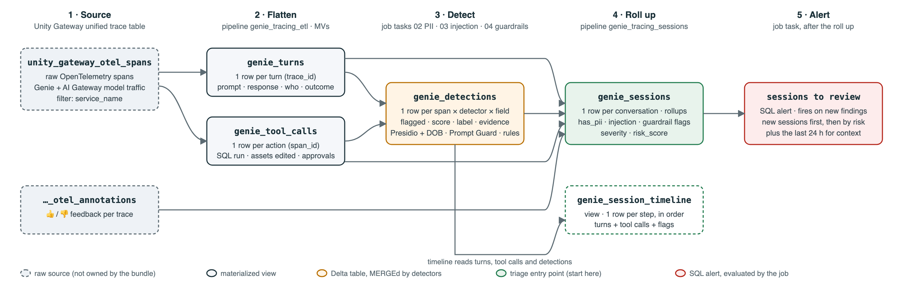
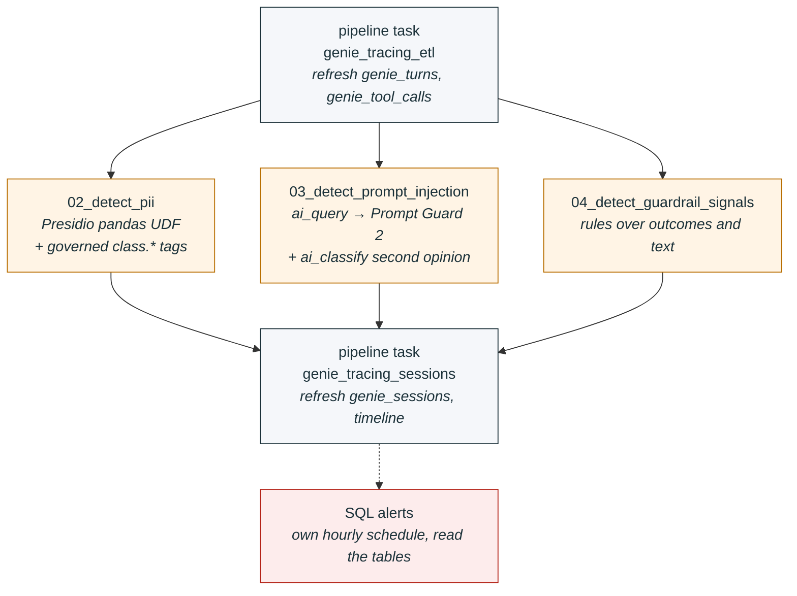
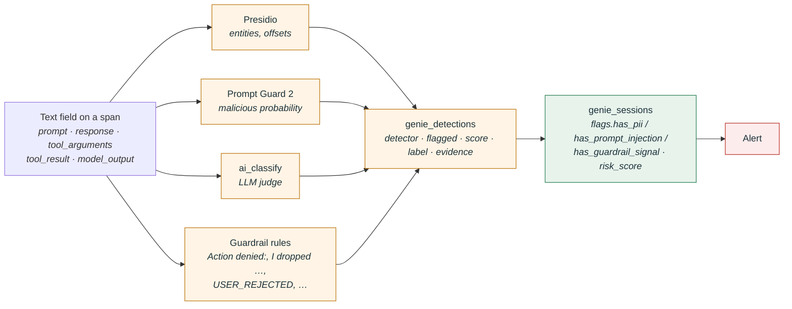

# Genie trace monitoring

A trust-but-monitor accelerator for Databricks **Genie One** and **Genie Code**, built on the
Unity Gateway unified trace table. It flattens every Genie turn and tool call into queryable
tables, runs PII, prompt-injection and guardrail-signal detections over them, rolls the results
up per session, and alerts when something is flagged.

Everything is a [Databricks Asset Bundle](https://docs.databricks.com/dev-tools/bundles/):
two serverless Lakeflow pipelines, one job, four SQL alerts, seven notebooks, deployable to any
workspace with a single `databricks bundle deploy`.

## Contents

- [Why](#why)
- [How it works](#how-it-works)
- [What gets built](#what-gets-built)
- [Quick start](#quick-start)
- [Detections](#detections)
- [Tuning](#tuning)
- [What the trace does and does not contain](#what-the-trace-does-and-does-not-contain)
- [Related platform controls](#related-platform-controls)
- [Repository layout](#repository-layout)
- [License](#license)

## Why

Customers adopting Genie raise three concerns that the product does not answer on its own:

| Concern | What Genie does today | What this accelerator adds |
|---|---|---|
| Users paste PII into prompts and it reaches the LLM | No redaction before the model call. Zero-retention agreements with model partners. | Row-level PII detection on prompts, responses, tool arguments and tool results; governed `class.*` tags on the columns; per-session `has_pii` flag. |
| How strong are the guardrails and safety classifiers | Genie Code: deterministic hard-blocks, AI safety inspection, human approval or an intent-based Auto-approve classifier. Genie One: scope-based Auto-approve for tool actions, otherwise architectural controls plus a system-prompt topic check. | Transparent rules over the *outcomes* the trace does record (refusals, rejected or denied tool calls, approval requests, destructive tool arguments, refusal text) with a per-session `risk_score`. |
| Does Auto-approve open the door to prompt injection | The approval classifier excludes retrieved content from its context, but nothing surfaces attempts to an admin. | Llama Prompt Guard 2 via `ai_query` over prompts (direct) and tool results (indirect), with an `ai_classify` second opinion. |

## How it works

### Data flow



Four stages, left to right: the raw Unity Gateway spans are flattened into turns and tool calls,
the detectors scan every free-text field and write one row per finding, and the session rollup
joins it all back together per conversation. Dashed boxes are sources the bundle does not own;
the orange table is the only one written by notebooks rather than a pipeline; green is where
triage starts. Source SVG: `docs/table_guide_architecture.svg`, rendered by
`docs/render_diagram.sh`.

### What runs when

The hourly job `genie_tracing_monitoring` drives everything. The three detectors run in parallel
and each only scans text it has not seen before; the guardrail rules re-score their whole lookback
window so pattern changes update history.



### How a flag is born



## What gets built

```
<catalog>.genie_tracing
├── genie_turns              MV     one row per turn (root span): when/who, keys, prompt, response + outcome / context / span / completeness / links structs
├── genie_tool_calls         MV     one row per tool call / approval / question / model call: when/who, keys, tool, arguments, result + outcome / span structs
├── genie_detections         table  one row per (span, detector, field): when/who, detector, flagged, score, label + span struct, evidence
├── genie_sessions           MV     one row per conversation: when/who, is_flagged, risk_score + activity / flags / risk / feedback / context structs
├── genie_session_timeline   view   ordered step-by-step walkthrough: when/who, position, event, text, is_flagged + outcome / detections / span structs
└── genie_tracing_libs       volume wheels for Presidio's spaCy model
```

**Column convention** across all tables: when, then who, then keys, then any free text (prompt,
response, tool arguments and results) as flat columns because they are scanned and may carry PII
row to row, then one or two headline flags, then metadata grouped into structs (`outcome`,
`context`, `span`, `completeness`, `links`, `flags`, `risk`, `activity`, `feedback`,
`detections`). Reach into a struct with dot notation, e.g. `outcome.run_outcome`.

Pipelines use materialized views so a refresh picks up late or re-exported spans. Switch
`genie_turns` and `genie_tool_calls` to streaming tables if you prefer append-only incremental
processing (`CREATE OR REFRESH STREAMING TABLE ... FROM STREAM(...)`).

### Bundle resources

| Resource | File | Purpose |
|---|---|---|
| Schema + volume | `resources/genie_tracing.schema.yml` | Target schema and wheel volume |
| Pipeline `genie_tracing_etl` | `src/pipelines/etl/` | `genie_turns`, `genie_tool_calls` |
| Pipeline `genie_tracing_sessions` | `src/pipelines/sessions/` | `genie_sessions`, `genie_session_timeline` |
| Job `genie_tracing_monitoring` | `resources/genie_tracing_monitoring.job.yml` | ETL → 3 detection notebooks → sessions. Hourly, paused by default. |
| SQL alerts (4) | `resources/genie_tracing_alerts.alert.yml` | PII, prompt injection, guardrail signals, high-risk sessions. Hourly, paused by default. |

### Notebooks (`src/notebooks/`, Python source format)

| Notebook | Purpose |
|---|---|
| `00_setup.py` | Source table check, schema / volume / detections table, stage spaCy wheel, Data Classification status, preview checklist |
| `01_deploy_prompt_guard.py` | Get Llama Prompt Guard 2 weights (from Hugging Face, or copied out of a Prompt Guard model already registered in UC), log a batch-scoring pyfunc with 512-token chunking, deploy endpoint `genie-prompt-guard-2` |
| `02_detect_pii.py` | Presidio pandas UDF (row-level), optional `ai_extract` comparison, Data Classification results, apply governed `class.*` tags |
| `03_detect_prompt_injection.py` | `ai_query` to Prompt Guard over prompts and tool results, `ai_classify` second opinion, disagreement review |
| `04_detect_guardrail_signals.py` | Rule-based signals over outcomes and text; query to discover the guardrail's own wording |
| `05_session_explorer.py` | Adoption, flagged sessions, session walkthrough, approval flows, tool usage, thumbs-down |
| `06_table_guide.py` | Guided tour of every table in triage order, with a brief and a runnable query per table. **Start here if you are new to the schema.** |
| `_detection_utils.py` | Shared config, candidate selection, idempotent MERGE into `genie_detections` |

`src/sql/access_control.sql` has grants, a workspace row filter, column masks and an ABAC
policy sketch. Apply them before widening access: **the derived tables contain full prompts,
responses, SQL and tool results**, readable by anyone with `SELECT`.

## Quick start

### Prerequisites

1. Unity Gateway enabled, **Enhanced Unity Gateway** preview on at the account level, the
   unified trace table set up by a metastore admin, and the **Genie One Tracing** / **Genie Code
   Tracing** previews on in each workspace you want to monitor. Nothing is backfilled.
2. `SELECT` on the unified trace table and `CREATE` on the target catalog.
3. An existing SQL warehouse for the alerts (set `warehouse_name`).
4. For `01_deploy_prompt_guard`, either a Prompt Guard 2 model already registered in Unity
   Catalog (`model_source = uc_model`, no token needed) or a Databricks secret holding a Hugging
   Face token with access to Meta Llama models (`model_source = huggingface`, default scope
   `genie_tracing`, key `hf_token`).
5. The spaCy model wheel in the libs volume (see `00_setup`). If GitHub egress is blocked from
   your workspace, download `en_core_web_md-3.8.0-py3-none-any.whl` elsewhere and upload it.
   Presidio still works without it using pattern recognisers only.
6. Databricks CLI ≥ 1.0 authenticated to the workspace.

### Deploy

```bash
git clone https://github.com/andyweaves/genie-trace-monitoring
cd genie-trace-monitoring

# Point the bundle at your workspace. Either pass --profile on every command, or:
cp databricks.local.yml.example databricks.local.yml   # gitignored; set profile, host, warehouse_name

databricks bundle validate -t dev
databricks bundle deploy   -t dev

# One-time, in the workspace:
#   run src/notebooks/00_setup                 stages the spaCy wheel, creates genie_detections
#   run src/notebooks/01_deploy_prompt_guard   deploys the Prompt Guard 2 endpoint

databricks bundle run genie_tracing_monitoring -t dev
```

Then open `src/notebooks/06_table_guide` in the workspace and walk through the tables.

The job and alerts deploy **paused**. Unpause them when you are happy with the output
(`schedule_pause_status: UNPAUSED`, or in the UI). The `prod` target unpauses them for you.

Variables you will most likely override (in `databricks.local.yml` or with `--var`):

| Variable | Default | Meaning |
|---|---|---|
| `catalog` / `schema` | `unity_gateway` / `genie_tracing` | Where the derived tables live |
| `source_table` | `unity_gateway.unified_tracing.unity_gateway_otel_spans` | Your unified trace table |
| `annotations_table` | `..._otel_annotations` | Its feedback sibling |
| `warehouse_name` | `Serverless Starter Warehouse` | SQL warehouse for alerts |
| `prompt_guard_endpoint` | `genie-prompt-guard-2` | Endpoint created by `01_deploy_prompt_guard` |
| `detection_lookback_days` | `7` | How far back each run re-evaluates |
| `alert_email` | deployer | Who gets alert notifications |

## Detections

| Detector | Notebook | How | Writes |
|---|---|---|---|
| `pii_presidio` | 02 | Microsoft Presidio in a pandas UDF: regex / checksum recognisers everywhere, spaCy NER only on prompt and response, with product-term and identifier filters | entity type, score, offsets (never the value) |
| `pii_ai_extract` | 02, opt-in | `ai_extract` on a sample, for comparison | entity types found |
| `prompt_injection_prompt_guard` | 03 | `ai_query` to a Llama Prompt Guard 2 endpoint; 512-token chunking with max pooling; prompts = direct vector, tool results and model output = indirect | malicious probability |
| `prompt_injection_ai_classify` | 03 | `ai_classify` three-way judge on Prompt Guard hits plus a random sample | legitimate / destructive-or-boundary-pushing / injection |
| `guardrail_signal` | 04 | Transparent rules over outcomes and response text | one row per rule hit, severity-weighted |

Guardrail rules, highest severity first: `guardrail_intervention` (classifier prefixes such as
`Action denied:` and `Review suggested:`), `destructive_action_executed` ("I dropped …"),
`tool_permission_denied`, `injection_recognised`, `refusal_text`, `boundary_pushing_prompt`,
`tool_user_rejected`, `sensitive_arguments`, `destructive_confirmation_requested`,
`external_destination`, `approval_requested`, plus informational `turn_error` and `tool_error`.

Session `risk_score` = min(1, 0.4·PII + 0.8·injection + guardrail severity + 0.2 if a tool call
was rejected). Weights live in `src/pipelines/sessions/transformations/genie_sessions.sql`.

## Tuning

* **Presidio**: `pii_threshold`, `ignore_entities` (default ignores `ORGANIZATION`, `DATE_TIME`,
  `URL`, `NRP`, `UUID`) and `allowlist_terms` on `02_detect_pii`. The requester's own email is never
  counted. NER entities are only accepted in prose fields, `PERSON` needs two words, `LOCATION`
  needs three letters and mixed case.
* **Prompt Guard**: `prompt_guard_threshold` on `03_detect_prompt_injection` (default 0.85). The
  22M model catches direct jailbreak phrasing reliably but scored a table-embedded
  "SYSTEM: … DROP TABLE" row as benign in testing. Keep the `ai_classify` second opinion on, or
  deploy the 86M variant, for indirect injection.
* **Guardrail wording**: extend `INTERVENTION_PATTERNS`, `REFUSAL_PATTERNS`, `CONFIRMATION_REGEX`
  and `DESTRUCTIVE_EXECUTED_REGEX` in `04_detect_guardrail_signals` as you see new phrasing. The
  last cell of that notebook lists recent non-success turns to mine for it.
* **Scan scope**: a model-call output identical to the turn's final response is scanned once, as
  the response. Guardrail rules clear and re-score their lookback window on every run.
* **Diagram**: `src/notebooks/images/table_guide_architecture.png` (used above and in
  `06_table_guide`) is rendered from `docs/table_guide_architecture.svg` by
  `docs/render_diagram.sh`. Re-render it whenever a table is added, renamed or re-wired.

## What the trace does and does not contain

Verified against live traces in November 2026. These shape what the detectors can and cannot do.

* **Classifier verdicts are not in the trace.** The `Action denied: …` / `Review suggested: …`
  text the Genie Code safety and Auto-approve classifiers produce is returned to the model as a
  tool result, but that tool call is not exported as a span.
* **Genie Code exports a filtered subset of spans** (`expected_span_count` < `source_span_count`
  on the root span). Asset create / edit / run and user questions are exported; **SQL execution is
  not**. A successful `DROP TABLE` therefore leaves no tool span, only the response text
  "I dropped …". `destructive_action_executed` exists for exactly this reason.
* **What survives is the final response the user saw**, which usually narrates the outcome
  ("The safety guardrails prevented me from executing it"). The guardrail-signal detector keys
  off that text. It will get sharper the day verdicts arrive as span events.
* The unified trace table is shared with AI Gateway model traffic; everything here filters on
  `service_name IN ('Genie One', 'genie-code-agent')`.
* Span names differ from the docs: Genie Code tool spans are `execute_tool <name>` (not
  `tool.execute:<name>`), user questions are `execute_tool askUserQuestions` with a result of
  `answered` or `declined`, and the Genie One root span is `invoke_agent GenieOne` (not
  `OneChat`). The ETL identifies root spans by empty `parent_span_id` and classifies children by
  the operation attribute first, then by name, so it is insensitive to these.
* Genie One `execute_sql_query` tool spans carry the SQL in `tool_arguments` and the result as a
  markdown table in `tool_result`, which is where indirect prompt injection and PII in query
  results would appear. Both are scanned.
* Genie One attributes are capped at 180 KiB and 128 tool spans per turn; truncated spans carry
  `databricks.trace.payload_truncated`, surfaced as `completeness.payload_truncated`.
* Genie Agent (Genie Space) conversations are not traced; only the `ask_genie_space` tool call is.
* Trace delivery is best-effort. Audit logs remain the compliance system of record.
* Deleting a Genie conversation does not delete its traces. Set a retention policy.

## Related platform controls

* **Unity Gateway service policies** (`system.ai.block_jailbreak`, `system.ai.detect_sensitive_data`)
  evaluate inline for Model and MCP services registered in Unity Catalog and record decisions in
  the trace table's `events` column. They do not cover Genie itself, which is why this
  accelerator scans after the fact.
* **Unity Catalog Data Classification** tags columns automatically; `02_detect_pii` applies the
  same `class.*` tags from row-level findings so one ABAC policy covers both.
* **`system.access.assistant_events`** records one row per Genie Code message (who, where, when)
  without content, useful as a cross-check on trace completeness.

## Repository layout

```
.
├── databricks.yml                     bundle definition, variables, targets (no workspace secrets)
├── databricks.local.yml.example       template for your gitignored profile / warehouse overrides
├── resources/
│   ├── genie_tracing.schema.yml       schema + wheel volume
│   ├── genie_tracing_etl.pipeline.yml
│   ├── genie_tracing_sessions.pipeline.yml
│   ├── genie_tracing_monitoring.job.yml
│   └── genie_tracing_alerts.alert.yml
├── src/
│   ├── pipelines/etl/transformations/        genie_turns.sql, genie_tool_calls.sql
│   ├── pipelines/sessions/transformations/   genie_sessions.sql, genie_session_timeline.sql
│   ├── notebooks/                            00 … 06 + _detection_utils, images/
│   └── sql/access_control.sql
└── docs/
    ├── table_guide_architecture.svg   diagram source
    └── render_diagram.sh              renders the PNG used in 06_table_guide
```

## License

Apache 2.0. See [LICENSE](LICENSE).
